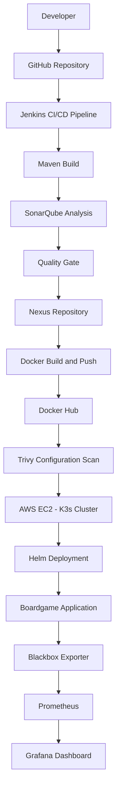
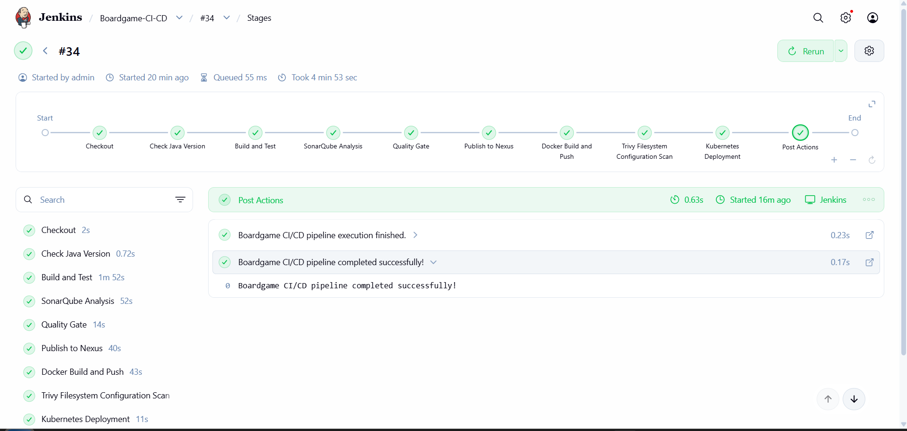
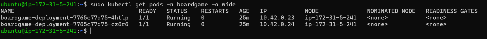
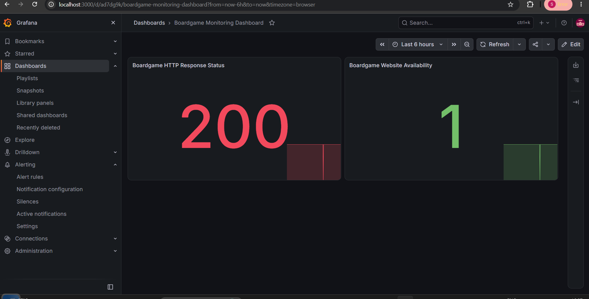

# Boardgame DevOps - Automated CI/CD and Cloud Deployment

**An end-to-end DevOps project demonstrating automated application delivery, Kubernetes deployment, and cloud monitoring.**

---

## 1. Project Overview

Boardgame DevOps is an end-to-end DevOps project that automates the process of building, analyzing, packaging, containerizing, deploying, and monitoring a Boardgame web application.

The project demonstrates how application source code moves from GitHub through an automated Jenkins CI/CD pipeline and is ultimately deployed to a Kubernetes cluster hosted on AWS.

It integrates CI/CD automation, code quality analysis, artifact management, Docker containerization, Kubernetes orchestration, security scanning, and application monitoring into one workflow.

**Project Goal:** To understand and implement a practical DevOps workflow that makes application delivery more automated, reliable, and easier to monitor.

## 2. Project Architecture

The following diagram represents the overall application delivery and monitoring workflow.



## 3. CI/CD Pipeline Workflow

Jenkins automates the application delivery process through the following stages.

| Stage | Description |
|---|---|
| Checkout | Retrieves application source code from GitHub |
| Check Java Version | Verifies the Java environment |
| Build and Test | Builds the application using Maven |
| SonarQube Analysis | Analyzes source code quality |
| Quality Gate | Checks the SonarQube quality gate |
| Publish to Nexus | Publishes the build artifact to Nexus Repository Manager |
| Docker Build and Push | Builds the application image and pushes it to Docker Hub |
| Trivy Configuration Scan | Scans project configuration files for security issues |
| Kubernetes Deployment | Deploys the application to the Kubernetes cluster |
| Post Actions | Performs pipeline post-build actions |

**Note:** Maven tests were skipped in the final successful pipeline execution. The build and deployment stages completed successfully.

### Jenkins Pipeline Execution

The following screenshot shows the Jenkins Stage View with the completed pipeline stages.



## 4. AWS and Kubernetes Deployment

The application is deployed on an AWS EC2 Ubuntu server using **K3s**, a lightweight Kubernetes distribution.

### Deployment Highlights

- AWS EC2 provides the cloud-hosted environment.
- K3s manages the Kubernetes cluster.
- Kubernetes Deployment manages application pods.
- Two application replicas are configured for availability.
- A NodePort Service exposes the application.
- Helm is used for Kubernetes package and deployment management.
- Resource requests and limits help manage container resources.
- Health probes help Kubernetes monitor application health.
- The application runs using a non-root container configuration with restricted capabilities.

### Kubernetes Deployment Verification

The following screenshot shows the running application pods in the Kubernetes cluster.



### Application Access

The application is exposed through Kubernetes NodePort **31709**.

```text
http://<AWS-EC2-Public-IP>:31709
```

Replace `<AWS-EC2-Public-IP>` with the current public IPv4 address of the EC2 instance.

## 5. Monitoring and Observability

Monitoring is an important part of this project. Prometheus, Grafana, and Blackbox Exporter are used to observe application availability and HTTP response status.

### Monitoring Components

| Tool | Purpose |
|---|---|
| Prometheus | Collects and stores monitoring metrics |
| Grafana | Visualizes metrics through dashboards |
| Blackbox Exporter | Checks application availability and HTTP responses |

### Monitoring Workflow

1. Blackbox Exporter probes the deployed Boardgame application.
2. Prometheus collects the probe metrics.
3. Grafana displays the monitoring information.
4. The dashboard helps identify application availability and HTTP response status.

### Grafana Monitoring Dashboard

The following screenshot shows the Grafana dashboard created for application monitoring.



### Monitoring Verification

Application availability and HTTP status were verified using the following Prometheus queries.

**Application availability:**

```promql
probe_success{job="boardgame-blackbox"}
```

**HTTP response status:**

```promql
probe_http_status_code{job="boardgame-blackbox"}
```

Verified results:

- `probe_success = 1` - Application probe succeeded.
- `probe_http_status_code = 200` - Application returned HTTP OK.

## 6. Technology Stack

| Category | Technologies |
|---|---|
| Application | Java, Spring Boot |
| Build Tool | Maven |
| Source Code Management | Git, GitHub |
| CI/CD | Jenkins |
| Code Quality | SonarQube |
| Artifact Repository | Nexus Repository Manager |
| Containerization | Docker |
| Container Registry | Docker Hub |
| Security Scanning | Trivy |
| Cloud Platform | AWS EC2 |
| Container Orchestration | Kubernetes (K3s) |
| Deployment Management | Helm |
| Monitoring | Prometheus, Grafana |
| Availability Monitoring | Blackbox Exporter |
| Operating System | Ubuntu Linux |

## 7. Security and Reliability

Security and reliability practices incorporated into this project include:

- SonarQube source code quality analysis.
- Automated configuration security scanning using Trivy.
- Kubernetes resource requests and limits.
- Application health checks.
- Non-root container execution.
- Restricted container capabilities.
- Kubernetes-based application deployment and replica management.

**Security Observation:** Trivy reported a medium-severity KSV-0125 finding related to the Docker Hub image registry being treated as untrusted. This finding requires further review and remediation. The project does not claim a completely clean security scan.

## 8. Key Learning Outcomes

Through this project, I gained practical experience with:

- Creating and understanding an end-to-end CI/CD pipeline.
- Automating application builds using Jenkins and Maven.
- Integrating SonarQube for code quality analysis.
- Managing build artifacts using Nexus.
- Building and publishing Docker images.
- Scanning configurations using Trivy.
- Deploying applications to Kubernetes on AWS.
- Managing deployments using Helm.
- Monitoring application availability with Prometheus and Grafana.
- Troubleshooting deployment, networking, and infrastructure issues.

## 9. Future Improvements

Possible improvements for this project include:

- Integrating Amazon ECR as a trusted container registry.
- Adding automated rollback strategies.
- Introducing infrastructure provisioning using Terraform.
- Adding notification integrations for pipeline failures.
- Improving security scanning and vulnerability remediation.
- Implementing centralized application logging.

## 10. Author

**Supriya Reddy A.**

Aspiring DevOps Engineer | Cloud Computing Enthusiast

**GitHub Profile:** [Supriyareddy1906](https://github.com/Supriyareddy1906)

**Project Repository:** [Boardgame-DevOps-CI-CD](https://github.com/Supriyareddy1906/Boardgame-DevOps-CI-CD)

---

*Thank you for exploring this project!*
